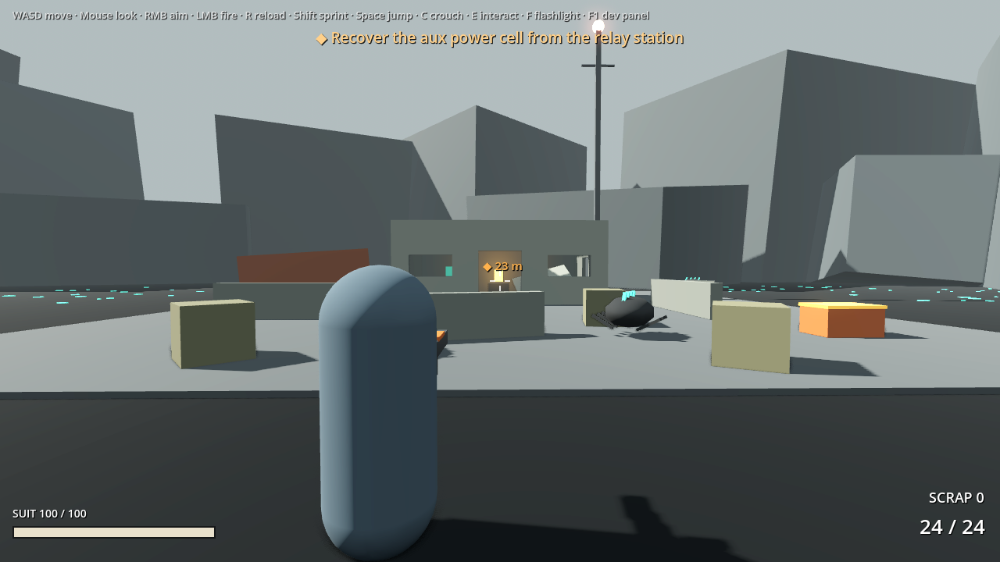

# Hard Landing

Third-person sci-fi shooter in Godot 4.7.2. You crash-land on a hostile planet aboard Kestrel, a salvage ship, and restore her one recovered component at a time.

The whole repair campaign is playable: seven expeditions, each recovering one component for a visible repair with a benefit, ending with lift-off. The build plan for the rest of the game is in [AUTONOMOUS_PLAN.md](AUTONOMOUS_PLAN.md).

## The campaign

Each repair is one expedition. Follow the site's beacon (only the site you need flashes bright, and only it pings), recover the component, carry it home on your back (no sprinting) and install it. Taking a component stirs up an ambush. Components found out of order say what Kestrel needs first.

| # | Repair | Site | Beacon | Twist | Benefit |
| --- | --- | --- | --- | --- | --- |
| 1 | Aux power | Relay station | Red | Ambush on the way home | Lights, screens, fabricator online |
| 2 | Cooling | Hauler wreck in the hot springs | Blue-white strobe | Steam vents burst on a cycle | Heavy fabricator builds |
| 3 | Canopy | Survey skiff *Lark* on the basalt spires | Yellow | Climb three platforms of columns | Scanner marks crates and wildlife on the HUD |
| 4 | Landing gear | Mining crawler in the quarry | Violet | Dark maintenance bay, rockfalls | Ship levels, cargo ramp opens, armoury locker resupplies |
| 5 | Wing | Dropship *Ferro-9* in the moss field | Green | Spore fog, spore pods burst when approached or shot | Point-defence turret on the wing root |
| 6 | Engine | Freighter *Long Patience* graveyard | White | Maze of hull plates, live arc conduits | Top fabricator tier (rapid cycler, reinforced plating) |
| 7 | Navigation | The Loom spire | Teal | The spire sends out rings of force: jump them | Pilot's seat starts the engine spool: hold the hull for 90 s, then launch |

Scuttlers at each site stay asleep until you get near. If you go down, you're hauled back to Kestrel with full health and keep what you carry.

## Open it

- **Godot 4.7.2:** Import `godot/project.godot`, then press F5. The ship and terrain also show in the editor.
- **Blender 4.2+:** Open `blender/kestrel_blockout.blend`, or rebuild it with
  `blender --background --python blender/kestrel_blockout.py`.
  This also re-exports `godot/assets/kestrel_blockout.glb`.

## Controls

| Key | Action |
| --- | --- |
| WASD / mouse | Move / look (click to capture the mouse) |
| Esc | Pause menu: mouse sensitivity, invert Y, volume, difficulty; save and quit to title |
| Right mouse / left mouse / R | Aim / fire / reload |
| 1 / 2 / 3, mouse wheel | Rifle / scattergun / arc lance (the ones you own) |
| Q | Use a stim (heals 55; carry 3, or 5 with the stim pouch) |
| Tab or I | Inventory: weapons, ammo, stims, upgrades, components |
| L | Logs: read the newest data slate, or the list of all of them |
| Shift / Space / C | Sprint / jump / crouch (crawlways need crouch) |
| E | Interact: take components, search crates, install, fabricate, rest in the bunk (saves) |
| F | Flashlight |
| F1 | Dev panel |

With the dev panel open: 1-7 toggle each repair (the campaign follows), N toggles day and dusk, K gives 50 scrap, T jumps to the current site's component and H jumps home. The panel also shows the camera boom length and says SQUEEZED when a wall pushes the camera in.

## What each repair changes

| # | Repair | Damaged | Repaired |
| --- | --- | --- | --- |
| 1 | Aux power | Dead generator, red emergency lights | Amber lights, live screens, glowing core |
| 2 | Cooling | Broken pipe run, open floor hatch | Continuous salvaged pipes with brackets, hatch closed |
| 3 | Canopy | Cracked, taped glass, one pane missing | Clear glass, new mullions |
| 4 | Landing gear | Crushed struts, ship rolled 4° and nose down 3° | Struts down, ship rises and levels over 3 seconds |
| 5 | Wing | Port tip torn off and lying on the ground | Salvaged tip panel with a reinforced joint |
| 6 | Engine | Port nacelle crushed, debris trail | Replacement nacelle in a mismatched bare-metal finish |
| 7 | Navigation | Mast lying flat on the spine | Mast, dish and nav lights |

Replacement parts use a mismatched grey-green salvage finish on purpose, so the repairs stay readable as patches.

## Story

Juno Vale's salvage ship *Kestrel* is down on HD-4471 b, "the Kettle", pulled out of the sky like every ship before her. HOB, Kestrel's ship mind, comes back with aux power and talks Juno through each repair. Across the seven sites, 22 logs (in salvage crates and with each component) tell the story of the people the Kettle caught: relay technician Ilse Marrow, Captain Gant of the *Brightwater*, survey pilot Pell Adair, the quarry crew, the *Ferro-9* rescue team, and the sixty-year-old wreck of the *Long Patience*. Ilse worked out that the Loom under the basin pulses on a beat, and she built the nav core that lets a ship fly in the gap.

**The finale.** With the nav core in, the pilot's seat starts a 90-second engine spool, and every animal in the basin comes for the hull. A breach dumps the spool and you can try again. Once the spool is full, get back to the seat and launch: the Loom's pulse rolls underneath and misses, and the ending card follows.

## Combat, gear and saving

- **Weapons.** The rifle has unlimited reserve. The scattergun is in the armoury locker once the landing gear is fixed: 8 pellets that fall off past 8 m, 6 shells and 36 in reserve. The arc lance is fabricated after the engine repair: 4 charges that pierce up to four targets. Crates and kills drop ammo for what you carry.
- **Fabricator.** Upgrades unlock with repairs: extended mag, stim pouch, plating I and II, heavy rounds, regen servo, rapid cycler, scattergun choke, arc capacitor, the arc lance itself, and stims at 15 scrap each.
- **Wildlife.** Scuttlers lunge; spitters keep 8 to 16 m away and lob acid that leaves a burning puddle; rams paw, then charge, and their head plate soaks 75% of damage from the front, so flank them or bait them into rock to stun them (double damage). The Warden guards the nav core: armoured until it opens up after an attack, and it calls the pack at two-thirds and one-third health.
- **Sieges.** After the canopy, landing gear and wing repairs, wildlife comes for Kestrel the next time you are home: waves aimed at the hull, with a hull bar. Hold it for scrap and a stim. If the hull breaks you lose a quarter of your scrap and they come back later. You can't launch while they're on the hull.
- **Difficulty.** Story, Normal or Hard, on the title screen or in the pause menu: changes damage taken and wildlife health, and Hard adds more wildlife.
- **Saving.** Resting in the bunk saves, and so do installing a repair and quitting to the title. Continue on the title screen loads `user://save.json`.

## How it's built

- `godot/data/kestrel_layout.json` holds the single source of truth: room sizes, openings, stairs, fixtures and repair mount points, all in deck-plan metres. Godot and Blender both read it, so changing a room there changes both.
- `godot/scripts/kestrel.gd` generates the hull and walls as one CSG solid, plus fixtures, lights and the seven repairables.
- `godot/scripts/repairable.gd` is the damaged/repaired pattern. Each repair is a node at its mount point with a damaged child and a repaired child, and only one of them is visible and collidable. It also accepts the `<id>_damaged` / `<id>_repaired` names that Blender exports, so real modelled parts can drop in later.
- `godot/scripts/game.gd` (autoload `Game`) holds the session state: scrap, what you carry, upgrades, repair states, the objective and shared physics layers.
- `godot/scripts/campaign.gd` is the repair campaign as data: each repair's site, component, objective text and install prompts. The current repair is always the first one Kestrel still has damaged, so dev toggles drive the campaign too.
- `godot/scripts/expedition_site.gd` is the base for every site: component, crates, resident pack, ambush points, beacon and save state. Each site script (`relay_station.gd`, `hauler_wreck.gd`, `spire_skiff.gd`, `quarry_crawler.gd`, `moss_dropship.gd`, `freighter_graveyard.gd`, `loom_spire.gd`) fills in its layout.
- `godot/scripts/timed_hazard.gd` is the quiet / warning / active cycle shared by `rockfall.gd`, `arc_gap.gd` and `spore_pod.gd`. `loom_pulse.gd` is the expanding ring at the spire. `point_defense.gd` is the wing turret.
- `godot/scripts/player.gd` and `weapon.gd` handle third-person movement and over-the-shoulder aim. The rifle is hitscan from the camera, so shots land on the crosshair, with tracers drawn from the muzzle. It has a 24-round magazine.
- `godot/scripts/enemy.gd` is the shared wildlife base: health, damage scaling by hit direction, pack alerts, leash range, ray-feeler steering and drops. `scuttler.gd`, `spitter.gd` (with `acid_glob.gd` / `acid_puddle.gd`), `ram.gd` and `warden.gd` extend it.
- `godot/scripts/ship_siege.gd` runs the attacks on Kestrel; `hull_point.gd` marks the places wildlife can hit the hull.
- `godot/scripts/story.gd` is the story as data: opening lines, HOB's lines for each repair and siege, the finale, the ending and every log with where it's found. `voice.gd` plays lines as subtitles in a queue (alarms interrupt). `log_panel.gd` is the log reader. `finale.gd` runs the engine spool and the launch cinematic hands off from `main.gd`.
- `godot/scripts/ui_panel.gd` is the pausing panel base for `fabricator_menu.gd` and `inventory_panel.gd`. `title.gd` (`scenes/title.tscn`) is the main scene.
- `godot/scripts/sfx.gd` (autoload `Sfx`) plays one-shots and loops from `godot/audio/<id>.wav`. Every sound is a placeholder generated by `tools/make_sfx.py` (needs numpy); drop a recorded WAV with the same name into `godot/audio/` to replace it. Loop points live in the WAV, so looping files need loop points set in your audio editor or the import dock.
- `godot/scripts/pause_menu.gd` is the Esc menu. Settings are saved to `user://settings.cfg`.
- `godot/scripts/steam_vent.gd` is the vent hazard: quiet, then a hiss and glowing crust as warning, then a burst that damages the player and scuttlers inside it.
- `godot/scripts/hud.gd` draws the objective, waypoint, crosshair and hit markers, ammo, suit health, scrap, prompts and damage flash.
- `godot/scripts/crash_site.gd` builds the basin: ridges, basalt columns, steaming pools, glowing moss, a plough berm and the crash furrow with debris. It uses a fixed seed, so the site looks the same every time.
- `blender/kestrel_blockout.py` builds the same layout in Blender: a single boolean shell (`Shell-col`), floors, fixtures, the exterior, and one mount empty per repair with placeholder volumes for both states. Model the real parts inside those empties.
- `godot/tests/` holds the headless tests. `smoke_test.tscn` plays the slice (audio, pause, ship routes, combat, the first two repair loops, fabricator, vents, death and respawn). `campaign_test.tscn` checks every site's layout and routes, every hazard, each repair loop in order with its benefit, and the launch. `mechanics_test.tscn` covers weapons, ammo, stims, the fabricator and inventory, every enemy, sieges, difficulty, balance numbers, save/load and the title screen. `story_test.tscn` checks the story data, where logs are found and that they save, when HOB and Juno speak, and the whole finale through to the ending card. Run one with `godot --headless --path godot res://tests/smoke_test.tscn`; GitHub Actions runs every `*_test.tscn` on each pull request. `screenshots.tscn` renders review shots (see the script header).

## Known gaps

- Enemies steer with ray feelers rather than a navmesh. They get round walls and wreckage, but a deep dead end can still trap one.
- Sounds are synthesised placeholders.
- The interior ambient darkening uses a reflection probe, which works in Forward+ only. The Compatibility renderer will look brighter inside.
